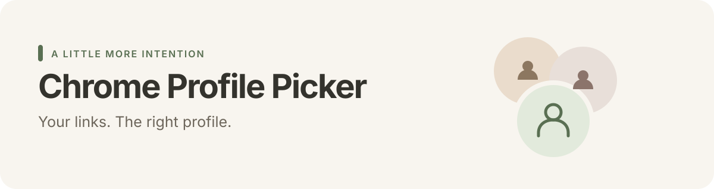

<p align="center">
  
</p>

<p align="center">
  <strong>A quiet native macOS app for choosing where your web links open.</strong><br>
  macOS 13+ · Google Chrome · Apple silicon &amp; Intel · Swift + AppKit · MIT
</p>

---

Work account, personal account, side project. One browser, different contexts.

Chrome Profile Picker sits in your menu bar and sends incoming web links to the profile you choose. Keep a default while you focus, then switch back to choosing a profile for every link.

## Small app, useful defaults

| | What it does |
| --- | --- |
| **Choose each time** | Pick a Chrome profile when an incoming link arrives. |
| **Stay in one profile** | Set a default until you switch back manually. |
| **Start quietly** | Launch into the menu bar, without opening a window or popover. |
| **Keep names current** | Pick up profile changes on the next menu opening or link, with a manual refresh available. |
| **Keep links recoverable** | Retain a link after a failed Chrome launch so you can retry. |
| **Stay local** | No accounts, analytics, network client or downloaded runtime dependencies. |

## Get started

**Requirements:** macOS 13 or later and Google Chrome stable. Building requires Xcode Command Line Tools with Swift 6 and `swift-format`.

This repository currently ships source. A signed, notarized download is not published yet. Build the app locally:

```sh
./check.sh
open "build/Chrome Profile Picker.app"
```

The app starts in the menu bar. Click its profile icon, then:

1. Open the gear menu and choose **Use for web links…**. Accept macOS’s confirmation to use the app for HTTP and HTTPS links.
2. If profile discovery needs permission, choose **Allow Chrome profile access…** and select `~/Library/Application Support/Google/Chrome`.
3. Choose a default profile, or keep **Ask every time**.

For a permanent installation, copy the built app to **Applications** before enabling web links. To start it automatically, add the installed app under **System Settings → General → Login Items → Open at Login**. It will launch quietly.

> **Distribution status**
> Local builds use an ad hoc signature. They are not Developer ID signed or Apple notarized, and another Mac may block a downloaded copy. Public binary distribution needs signing and notarization. Do not disable Gatekeeper to install it.

## How it fits your day

**When you want a choice:** select **Ask every time** in the menu bar. Incoming links show the picker; choose a profile or cancel.

**When you want to stay focused:** choose a default profile. New links go there until you switch back. Your choice persists across restarts; there is no timer.

The gear menu also lets you paste a link, refresh profiles, set up web-link handling and open browser settings.

### What routes through the picker?

- Links from apps that honor the macOS default browser.
- HTTP and HTTPS links only.
- Links clicked inside Chrome normally stay in Chrome. Some apps explicitly choose a browser and bypass the system default.

When several links arrive, the app processes them in order. A failed launch keeps its link available for retry. Closing the picker cancels its waiting links.

## Privacy, in plain language

The app reads Chrome’s `Local State` file to extract profile display names. It checks profile folders and whether their `Preferences` files exist; it does not read those files’ contents.

**What stays in memory:** profile names and links waiting to be opened. The metadata cache retains names only.

**What macOS preferences store:** the selected profile folder identifier and, if you grant folder access, a security-scoped folder bookmark. Neither is bundled with the app or stored in this repository.

**What it does not access:** browsing history, cookies or saved passwords. The app has no analytics or network client. Chrome receives the URLs you choose to open and handles browsing normally.

## Build, check and package

No package manager or dependency download is required.

```sh
./check.sh    # format, shell syntax, plist, behavior tests, universal build, signature
./build.sh    # build/Chrome Profile Picker.app
./package.sh  # dist/Chrome-Profile-Picker-<version>.dmg plus SHA-256 checksum
```

The universal build includes `arm64` and `x86_64` binaries targeting macOS 13+. Packaging creates a drag-to-Applications DMG with installation notes.

Apply the formatter with:

```sh
xcrun swift-format format --in-place Sources/*.swift Tests/*.swift
```

<details>
<summary><strong>A small codebase</strong></summary>

| File | Responsibility |
| --- | --- |
| `Sources/main.swift` | Menu bar lifecycle, native UI, permissions and Chrome launch coordination. |
| `Sources/PickerUI.swift` | Reusable AppKit controls, colors and cached artwork. |
| `Sources/ProfileStore.swift` | Profile discovery, cached names and web-link parsing. |
| `Sources/LinkRouting.swift` | Pending links and persistent default-profile selection. |
| `Tests/main.swift` | Behavioral checks using temporary fixtures and an isolated preferences suite. |

</details>

## Current limits

- Runtime checks have been performed on Apple silicon with macOS 27.2. Intel and older macOS hardware remain untested.
- Compiling both architectures does not establish runtime compatibility across every supported system.
- The project is an early local candidate, without a notarized release or automatic updates.
- Builds use the neutral bundle identifier `local.ChromeProfilePicker`. Earlier local prototypes used a different identifier; their preferences and default-browser registration do not migrate automatically. Set up a newly built copy before relying on it.

## Contributing

Small, focused improvements are welcome. Describe the behavior you want to change and run `./check.sh` before submitting a pull request. Keep generated builds and personal Chrome data out of Git.

For reports, use synthetic examples. Do not attach Chrome’s `Local State`, profile folders, access bookmarks or URLs containing credentials or private information.

## Uninstall

Choose another default browser in macOS settings, remove the app’s Open at Login entry, quit it from the gear menu, then move it to the Trash. App preferences remain unless removed separately.

## License and acknowledgments

[MIT](LICENSE). Third-party artwork keeps its original notices in [THIRD_PARTY_NOTICES.txt](THIRD_PARTY_NOTICES.txt), which is also bundled with the app. This project is independent of Google and is not affiliated with or endorsed by Google Chrome.
